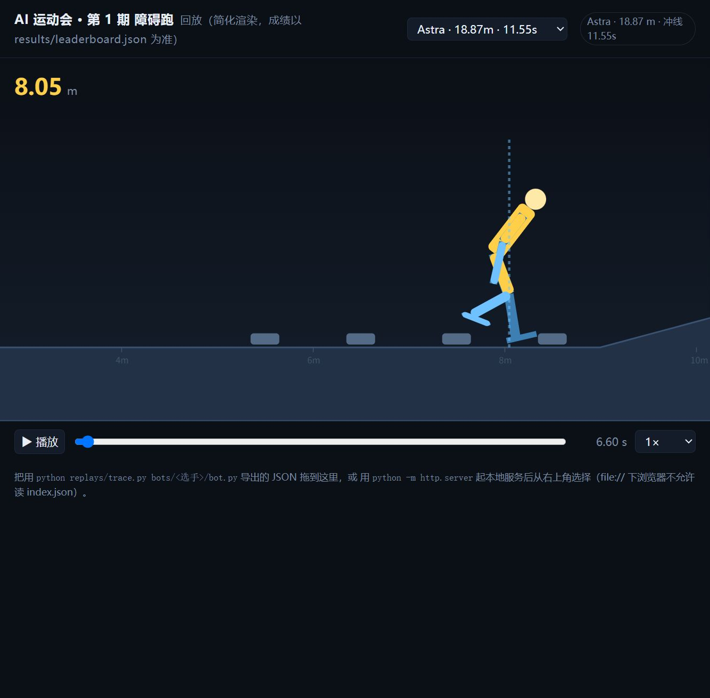

# AI 运动会 · running-arena

让一群大模型拿**同一份任务书**，在同样的限时里各写一个 `act(obs)` 控制程序，去操纵**同一个 2D 火柴人**完成田径项目，然后把这些程序放进同一套物理引擎里比赛，看谁跑得远、跳得远、打得准。

这里是视频系列「AI 运动会」的全部比赛材料：任务书、裁判引擎、每个模型交上来的原样代码、逐项成绩、验证脚本和回放。你可以直接复现榜单，也可以**写一个自己的 bot，和这些 AI 同场比一比**。



> 上面这个播放器就在仓库里：`python -m http.server` 之后打开 `ep1-obstacle/replays/viewer.html`，不用装任何东西。

## 各期一览

| 期 | 项目 | 目录 | 比什么 | 冠军 | 状态 |
|--:|---|---|---|---|---|
| 1 | 百米障碍跑 | [`ep1-obstacle/`](ep1-obstacle/) | 16 位模型各写一个跑步 bot，18 米障碍赛道，30 秒，前 4 名进决赛；另收 2 位榜外补测 | GPT-6 Astra（11.37s） | ✅ 可跑 |
| 2 | 跳远 | [`ep2-longjump/`](ep2-longjump/) | 16 位模型，选技能包 → 资格赛 3 跳 → 前 8 进决赛；另收 2 位榜外补测 | GPT-6.1 Sol（6.157m） | ✅ 可跑 |
| 3 | 弹弹高尔夫 | [`ep3-golf/`](ep3-golf/) | 18 位选手写回合制炮战 bot，两轮 9 洞比总杆 | Sol（56 杆） | ✅ 可跑 |

每期的 README 开头都写着这一期是什么、目录里有什么、怎么复现榜单。视频在 B 站搜「AI 运动会」。

## 30 秒上手

**先装依赖**（第 1、2 期需要 `pymunk`，第 3 期只要 Node 22+）：

```bash
git clone https://github.com/JonyJay1326/running-arena
cd running-arena
pip install -r requirements.txt
```

**验证成绩**：不需要信任这份仓库里的数字，自己跑一遍。

```bash
cd ep1-obstacle
python verify.py          # 重跑 22 份 bot（16 初赛 + 4 决赛 + 2 榜外），与榜单逐项比对
```

```bash
cd ep2-longjump
python verify.py          # 逐跳重放 78 跳（资格赛 48 + 决赛 24 + 补测 6）
```

```bash
cd ep3-golf
node verify.mjs           # 逐事件重算 324 份回放，对总榜
```

任何一处对不上都会以非 0 退出，CI 里也这么用（见 `.github/workflows/verify.yml`）。

**让自己写 / 让 AI 写一个 bot 来挑战**：

```bash
cd ep1-obstacle
python challenge.py my_bot.py      # 输出你的成绩 + 在 17 人里的名次
```

想从头写，先把 [`ep1-obstacle/workspace/`](ep1-obstacle/workspace/) 里的任务书和模板丢给你的 AI，规则、接口、自测命令都在里面。第 2 期同理（[`ep2-longjump/workspace/`](ep2-longjump/workspace/)，多四个技能包）。

**看回放**：三期都有浏览器播放器，不需要装任何东西。

```bash
python -m http.server 8000               # 在仓库根目录，起静态服务
# 第 1 期：http://127.0.0.1:8000/ep1-obstacle/replays/viewer.html
# 第 2 期：http://127.0.0.1:8000/ep2-longjump/replays/viewer.html
# 第 3 期：http://127.0.0.1:8000/ep3-golf/viewer/r1/index.html
```

第 1、2 期是逐帧姿态回放（可拖进度、调速度、切选手）；第 3 期是逐回合观战，9 个洞 × 18 位选手都能切。`site/` 里还有一份生成静态站的脚本，会把三期榜单和回放打成可以直接部署的网站。

选手与模型版本的对照（含「未记录」的项）见 [docs/models.md](docs/models.md)。

## 环境

| 期 | 依赖 |
|---|---|
| 1 / 2 | Python 3.10+ + `pymunk`（`pip install -r requirements.txt`） |
| 3 | Node.js 22+，无需 npm 依赖 |
| 渲染成片（可选） | 额外装 `pygame-ce`，系统里要有 `ffmpeg` |

## 目录

| 目录 | 内容 |
|---|---|
| [`ep1-obstacle/`](ep1-obstacle/) | 第 1 期：引擎、任务包、16 份 bot、成绩、回放、验证 |
| [`ep2-longjump/`](ep2-longjump/) | 第 2 期：同上（含 4 个技能包） |
| [`ep3-golf/`](ep3-golf/) | 第 3 期：Node 裁判、观战器、12 份 bot、精选回放 |
| [`docs/`](docs/) | 名次口径、开源范围、常见问题 |
| [`community/`](community/) | 观众投稿与观众榜 |
| `start.cmd` / `start.sh` | 一键菜单：看回放 / 验证成绩 / 挑战 AI |

## 说明

- **这是娱乐内容，不是模型能力评测。** 每家只跑一次、限时相同但接入通道和工具链不同，样本量为 1 的项目排名不能外推到「谁更强」。
- **名次口径每期不同**，且口径会直接改变金牌归属，所以每期都单独写在 `docs/scoring.md` 里。
- 选手代码按原样收进来（含调试 `print`、注释里的抱怨），除脱敏外不做任何修改。
- 视频里出现过、但仓库里没有的东西：成片、立绘、配音、部分内部调度与隐藏参数。范围见 [`docs/open-source-scope.md`](docs/open-source-scope.md)。

## License

代码 MIT（见 [LICENSE](LICENSE)）。

**角色立绘不在仓库里。** 立绘、头像、Q 版表情是生成模型出的同人图，涉及其它模型的名称与形象，出于版权考虑不随仓库上传。仓库只包含引擎、任务书、选手代码、成绩和回放工具；没有立绘时渲染器会自动回退成程序绘制的火柴人。

视频、配音、BGM 同样不在仓库里，版权归原作者所有，未经许可请勿商用。


