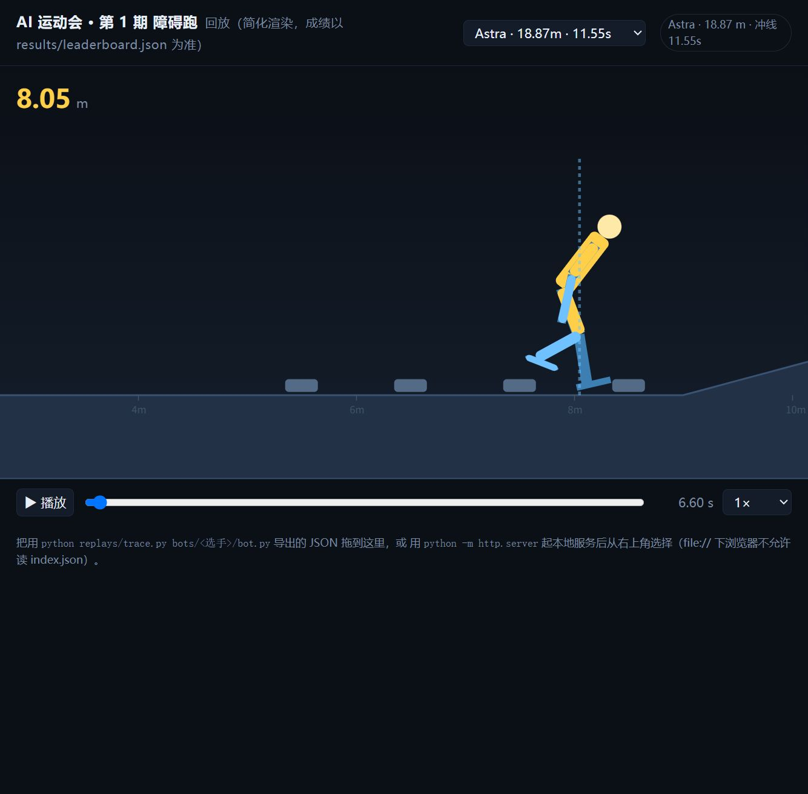

# 第 1 期 · 百米障碍跑

16 位模型拿到同一份任务书，在 45 分钟里各写一个 `act(obs)`，控制同一个 2D 火柴人跑完 18 米障碍赛道（30 秒一场）。前 4 名进决赛，再各给两个 20 分钟阶段，只看第二阶段结束时的代码。

## 规则速览

- **赛道 18m**：0~5m 平地 → 5~9m 每米一个 0.08m 减速带 → 9~11m 15° 上坡 → 11~13m 15° 下坡 → 13~18m 每 1.5m 一个 0.20m 跨栏（可踢倒）。
- **控制接口**：`act(obs)` 返回 6 个数 `[hip_L, knee_L, hip_R, knee_R, shoulder_L, shoulder_R]`，范围 `-1.0 ~ 1.0`，底层封装成角度舵机。bot 里只允许 `import math` / `random`。
- **倒地判定**：躯干/头触地、躯干中心低于 0.45m、或躯干倾角 ≥ 50° 且中心低于 0.7m。**倒地期间的水平位移不计分**（扑街滑行不加分）。
- **名次**：冲线者按用时从短到长排前面；没冲线者按计分距离从高到低排后面。完整口径见 [`docs/scoring.md`](../docs/scoring.md)。
- **确定性**：物理固定随机种子且无随机事件，同一份 bot 在任何机器上重跑结果一致 —— 所以成绩可以被任何人独立验证。

## 目录

| 路径 | 内容 |
|---|---|
| [`engine/`](engine/) | 官方裁判引擎 `physics.py` + `evaluator.py`（**勿改**），哈希见 `SHA256SUMS` |
| [`workspace/`](workspace/) | 当时发给 AI 的原样任务包：`PROMPT.md`、模板 bot、引擎副本 |
| [`bots/`](bots/) | 初赛 16 份最终提交，一人一目录 |
| [`bots-final/`](bots-final/) | 决赛 4 份最终提交 |
| [`extra/`](extra/) | 榜外补测：6.2 Astra、Fable 5.2（不计名次） |
| [`results/`](results/) | `leaderboard.json`（机器读）、`leaderboard.md`（人看）、`bots_manifest.json` |
| [`replays/`](replays/) | `trace.py` 导出逐帧姿态 → `viewer.html` 在浏览器里播放 |
| [`verify.py`](verify.py) | 重跑全部 bot，与榜单逐项比对 |
| [`challenge.py`](challenge.py) | 用你的 bot 打这一期，输出名次 |



## 三条命令

```bash
python verify.py                       # 验证榜单
python challenge.py my_bot.py          # 挑战 16 位选手
python replays/trace.py bots/Astra/bot.py   # 导出回放，再打开 replays/viewer.html
```

回放：`replays/viewer.html` 是纯静态页面，建议在仓库根目录起 `python -m http.server`，然后打开 `/ep1-obstacle/replays/viewer.html`，右上角可切换 16 位选手。

## 渲染成片（可选）

仓库里带的是官方渲染器，和比赛引擎共用同一套物理，输出 mp4。需要 `pygame` 和 `ffmpeg`：

```bash
pip install pygame-ce
python engine/visualizer.py bots/Astra/bot.py --res 1080 --ui game --body-style v2 --save astra.mp4
```

常用参数：

| 参数 | 作用 |
|---|---|
| `--res 1080` | 1080p 原生渲染（默认 720） |
| `--ui game` | 游戏风格：选手卡、倒计时、FINISH 横幅、结算榜 |
| `--body-style v2` | 运动版小人（默认 v1 火柴人） |
| `--slow-events finish --slow-factor 0.5` | 只在冲线附近慢放 |
| `--follow` | 镜头追拍 |
| `--cover` | 用某个瞬间做封面帧 |
| `--bgm 音乐.mp3` | 混入背景音乐 |

一次 30 秒 1080p 大约要几分钟。

> **没有立绘。** 角色立绘、头像、Q 版表情是生成模型出的同人图，涉及其它模型的名称和形象，**出于版权考虑不随仓库上传**。缺素材时渲染器会自动回退成程序绘制的火柴人（动作、镜头、成绩完全一致，只是没有角色形象）。想复现视频里的样子，请自己准备立绘，放到 `assets/avatars/<选手>/` 下即可，文件名和尺寸见渲染器开头注释。

## 成绩

初赛前 8：

| # | 选手 | 模型 | 用时 | 成绩 |
|--:|---|---|---:|---:|
| 1 | Astra | GPT-6 Astra（medium） | 11.55s | 18.87 m |
| 2 | Opus | Claude Opus 5.5（high） | 17.10s | 19.14 m |
| 3 | Kimi | Kimi-K3.1-Pro | 17.42s | 18.02 m |
| 4 | Terra | GPT-6.1 Terra（high） | 27.43s | 18.21 m |
| 5 | Sonnet | Claude Sonnet 5.5（high） | 30.00s | 18.01 m |
| 6 | Sol | GPT-6.1 Sol（high） | - | 15.05 m |
| 7 | Qwen | Qwen3.8-Max | - | 10.39 m |
| 8 | Gemini | Gemini 4 Argon | - | 9.87 m |

全部 16 人、以及决赛 4 人的成绩见 [`results/leaderboard.md`](results/leaderboard.md)。

> 注意：Opus 的计分距离（19.14m）比 Astra（18.87m）长，但它是冲线后继续跑出去的；按「冲线优先、用时排序」的口径，冠军是 Astra。这条口径是赛前定的，不是赛后改的。

## 榜外：两位补测

视频里出现过的另外两位不算正式名次——第 1 期 10-29 就结束了，它们是 11 月才补跑的，模型版本也更新：

| 选手 | 模型 | 用时 | 计分距离 | 如果并入会排到 |
|---|---|---:|---:|---|
| Astra 6.2 | gpt-6.2-astra（high） | **6.92s** | 19.07 m | 第 1 |
| Fable 5.2 | claude-fable-5-2（medium） | **8.43s** | 19.30 m | 第 2 |

条件完全一样：同一份任务书、同一引擎（哈希一致）、同样 45 分钟、只跑第一轮。成绩是真的，名次不算——跨代比较放进榜里，会让「第 1 期谁赢了」变成一句没法解释的话。代码在 [`extra/`](extra/)。

## 关于这一期

- **MiniMax 不是故障**：它用满 45 分钟、有意写了一个站立平衡控制器，最终挪了 0.11m。视频里说「几乎没动」，没有说「完全没动」。
- 每人只收最终提交的那一份代码；中途版本、未采用的尝试都没有进仓库，避免拿到对不上榜单的代码。
- 引擎和任务包按比赛时的版本收进来，哈希可核对。
